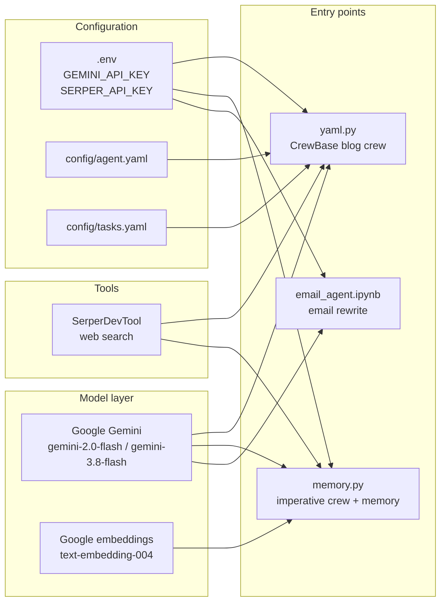
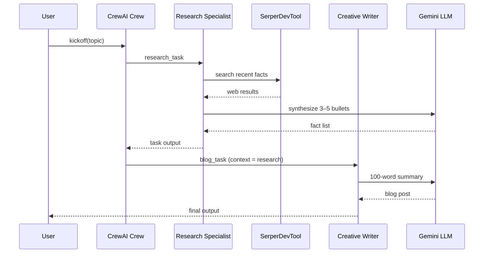
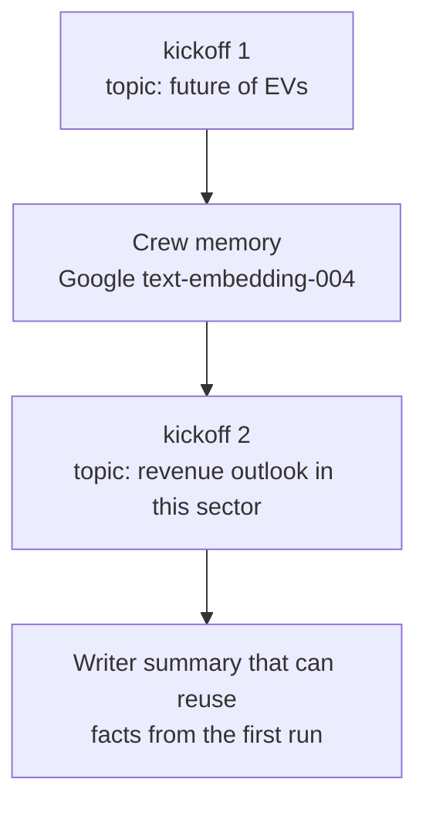

# Crew AI

[](https://www.python.org/)
[](https://www.crewai.com/)
[](https://ai.google.dev/)
[](https://docs.astral.sh/uv/)
[](https://github.com/kaziH436/crew-AI)

Multi-agent workflows built with [CrewAI](https://www.crewai.com/): research and write blog posts from a topic, persist context across runs with embeddings, and rewrite informal email into professional copy.

This repository is a hands-on lab rather than a hosted product. Each entry point is a small, runnable experiment that shows a different CrewAI pattern: imperative crews, YAML-configured crews, long-term memory, and a Jupyter notebook for interactive iteration.

**Repository:** [github.com/kaziH436/crew-AI](https://github.com/kaziH436/crew-AI)

---

## Table of contents

- [Overview](#overview)
- [Live demos](#live-demos)
- [Architecture](#architecture)
- [Key design decisions](#key-design-decisions)
- [Technologies](#technologies)
- [Project structure](#project-structure)
- [Prerequisites](#prerequisites)
- [Setup](#setup)
- [Run instructions](#run-instructions)
- [Configuration](#configuration)
- [Troubleshooting](#troubleshooting)
- [License](#license)

---

## Overview

The project currently includes three workflows:

| Workflow | Entry point | What it does |
| --- | --- | --- |
| YAML-configured blog crew | `yaml.py` | Loads agent and task definitions from `config/`, then runs a researcher (Serper search) followed by a writer. |
| Memory-enabled blog crew | `memory.py` | Same research → write pipeline, with CrewAI memory and Google `text-embedding-004` so a second kickoff can reuse prior context. |
| Email assistant | `email_agent.ipynb` | Single-agent crew that rewrites a rough email into a professional message using Gemini. |

A package stub lives in `src/crew_ai/` (`uv run crew-ai` prints a hello message). The crews above are the working examples.

---

## Live demos

There is no deployed web UI. The demos below are what you get when you run the project locally. Outputs are model-generated and will vary.

### Email assistant (notebook)

**Input**

```text
hey team, just wanted to tell u that the demo is kind of ready, but there's still stuff left.
Maybe we can show what we have and say rest is WIP.
Let me know what u think. thanks
```

**Observed run**

1. Load environment variables from `.env`.
2. Instantiate `LLM(model="gemini/gemini-3.8-flash", temperature=0.1)`.
3. Kick off a one-agent crew asynchronously (`await crew.kickoff_async()`).
4. The agent expands slang and abbreviations (for example WIP) and returns a formatted professional email.

Open and run the cells in `email_agent.ipynb` to reproduce this demo.

### Blog crew with tools

```bash
uv run python yaml.py
```

The researcher uses Serper to collect 3–5 recent facts about the default topic (`The future of electrical vehicles`). The writer then produces a ~100-word summary from those facts.

### Blog crew with memory

```bash
uv run python memory.py
```

The crew runs twice in one process:

1. Research and summarize electric vehicles.
2. Ask a follow-up about revenue outlook in the same sector, with memory enabled so the second run can draw on embeddings from the first.

---

## Architecture

### Repository layout (runtime)



### Sequential blog pipeline

Both blog crews use a sequential process: the writer does not search the web itself. It only consumes the researcher’s task output (and, in `memory.py`, stored embeddings).



### Memory-enabled follow-up



---

## Key design decisions

**YAML for agent and task definitions.** Roles, goals, backstories, and task prompts live in `config/` so you can change behavior without editing Python. `yaml.py` uses CrewAI’s `@CrewBase`, `@agent`, `@task`, and `@crew` decorators to bind those files to a crew class.

**Imperative crew for memory experiments.** `memory.py` constructs agents and tasks in Python so memory, the embedder, and two sequential `kickoff` calls stay visible in one file. That is easier to reason about when you are learning how CrewAI memory works.

**Tool use is limited to the researcher.** Only the research agent receives `SerperDevTool`. The writer is a language-only agent. That keeps search cost and hallucination surface on the fact-gathering step, and forces the writer to stay grounded in the previous task’s output via `context=[task1]`.

**Low temperature.** LLM calls use `temperature=0.1` so research bullets and email rewrites stay consistent and factual rather than highly creative.

**Google Gemini as the default model.** Crews use Gemini through CrewAI’s LLM adapter (`gemini/gemini-2.0-flash` in Python crews; the notebook uses `gemini/gemini-3.8-flash`). Memory uses Google’s `text-embedding-004` with `GEMINI_API_KEY`, so one provider covers generation and embeddings.

**Notebook for the email workflow.** Email rewriting is interactive (paste a draft, inspect the rewrite). Jupyter is a better loop for that than a one-shot CLI script.

**uv for environment and scripts.** `pyproject.toml` declares the project for [uv](https://docs.astral.sh/uv/). Python 3.14+ is required (see `.python-version`).

---

## Technologies

| Technology | Role |
| --- | --- |
| [Python](https://www.python.org/) 3.14+ | Runtime |
| [uv](https://docs.astral.sh/uv/) | Package manager, virtualenv, and `uv run` |
| [CrewAI](https://docs.crewai.com/) (`crewai[google-genai,tools]`) | Multi-agent orchestration, tasks, memory, Gemini extra, tools extra |
| [crewai-tools](https://docs.crewai.com/concepts/tools) | `SerperDevTool` (also imported: scrape, directory, and file tools in `yaml.py`) |
| [Google Gemini](https://ai.google.dev/) | Chat / completion LLM |
| [Google text-embedding-004](https://ai.google.dev/gemini-api/docs/embeddings) | Embeddings for CrewAI memory |
| [Serper](https://serper.dev/) | Google Search API used by the research agent |
| [python-dotenv](https://pypi.org/project/python-dotenv/) | Load `.env` into the process |
| [PyYAML](https://pyyaml.org/) | Agent/task config files |
| [Jupyter](https://jupyter.org/) | Interactive email-agent demo |

---

## Project structure

```text
crew-AI/
├── config/
│   ├── agent.yaml          # Research + writer roles, goals, backstories, LLM
│   └── tasks.yaml          # Research and blog task prompts
├── src/crew_ai/
│   └── __init__.py         # Package entry (`uv run crew-ai`)
├── email_agent.ipynb       # Email rewrite crew (async kickoff)
├── memory.py               # Imperative crew with memory + two kickoffs
├── yaml.py                 # @CrewBase crew loaded from YAML
├── main.py                 # Minimal placeholder
├── pyproject.toml          # Project metadata and dependencies
├── .python-version         # 3.14
├── .gitignore
└── README.md
```

---

## Prerequisites

- Python **3.14** or newer
- [uv](https://docs.astral.sh/uv/getting-started/installation/)
- A [Google AI Studio](https://aistudio.google.com/apikey) API key
- A [Serper](https://serper.dev/) API key (required for the research agent’s web search)

---

## Setup

Clone the repository:

```bash
git clone https://github.com/kaziH436/crew-AI.git
cd crew-AI
```

Create the virtual environment and install dependencies:

```bash
uv sync
```

Create a `.env` file in the project root (this file is gitignored):

```bash
GEMINI_API_KEY=your_gemini_api_key
SERPER_API_KEY=your_serper_api_key
```

CrewAI’s Gemini integration and the memory embedder both read `GEMINI_API_KEY`. `SerperDevTool` reads `SERPER_API_KEY`.

---

## Run instructions

All commands assume you are in the repository root after `uv sync`.

### YAML blog crew

```bash
uv run python yaml.py
```

Default topic is `The future of electrical vehicles`. To try another topic, change the `inputs` dict in `yaml.py`:

```python
blog_crew.crew().kickoff(inputs={"topic": "Your topic here"})
```

**Note:** `yaml.py` currently points at `config/agents.yaml` and `config/tasks.yaml`. The committed agent file is named `config/agent.yaml`. If CrewBase cannot load the agent config, rename the file to `agents.yaml` or update `agents_config` to match the filename on disk.

### Memory blog crew

```bash
uv run python memory.py
```

This prints two full crew runs. The second kickoff is a follow-up question about revenue outlook, with `memory=True`.

### Email assistant notebook

```bash
uv run jupyter notebook email_agent.ipynb
```

Run the cells in order: load `.env`, construct the Gemini LLM, then kick off the email crew.

### Package hello script

```bash
uv run crew-ai
```

Prints `Hello from crew-ai!` from `src/crew_ai/__init__.py`.

---

## Configuration

### Agents (`config/agent.yaml`)

| Agent | Role | Goal | Tools |
| --- | --- | --- | --- |
| `research_agent` | Research Specialist | Find interesting facts about `{topic}` | Serper (wired in Python) |
| `writer_agent` | Creative Writer | Write a short blog summary from the research | None |

Both YAML agents specify `llm: gemini/gemini-2.0-flash`.

### Tasks (`config/tasks.yaml`)

| Task | Expected output |
| --- | --- |
| `research_task` | Bullet list of 3–5 recent facts (as of 2025) |
| `blog_task` | ~100-word blog post summary |

### Changing the model

In `memory.py` and the notebook, pass a different LiteLLM-style model id to `LLM(...)`. In YAML, change the `llm:` field on each agent.

---

## Troubleshooting

| Symptom | Likely cause | What to do |
| --- | --- | --- |
| Authentication errors from Gemini | Missing or invalid `GEMINI_API_KEY` | Confirm `.env` exists and `load_dotenv()` runs before the LLM is created |
| Researcher cannot search | Missing `SERPER_API_KEY` | Add a Serper key; the writer will still run but facts will be weak |
| YAML crew fails to load agents | Filename mismatch (`agent.yaml` vs `agents.yaml`) | Align the path in `yaml.py` with the file in `config/` |
| `uv sync` / interpreter errors | Python older than 3.14 | Install 3.14+ or adjust `requires-python` if you intentionally target an older version |
| Memory does not affect the second run | Embedder key or provider misconfigured | Check `GEMINI_API_KEY` and the `embedder` block in `memory.py` |

---

## License

No license file is included in this repository. All rights reserved unless the owner adds a license.

If you use this project as a starting point, add an explicit license before sharing it as an open-source template.
